# AMAEA model (FE_Beta) — ODD inferred from the code

This ODD (Overview, Design concepts, Details; Grimm et al. 2006, 2010, 2020) describes **the current implementation** of the AMAEA food‑environment model, as found in the repository `amaea-model` at commit `3460a98` (first written for `89bba54`, then updated for the shopping trips, the food preference classes, the experiment scenarios and their probes). Everything below is inferred from the Pharo/Cormas source code (`src/FE_Beta-Model`, `src/FE_Beta-Model-UI`, `src/FE_Beta-Model-Tests`) and from Cormas methods the model calls. Nothing is taken from the external ODD or pseudocode documents linked in the README.

Where something cannot be inferred from the code, the section is left empty and marked *(not inferable from the code)*.

Method names are written `Class>>method` so they can be found in the image. Diagram sources are in `img/*.mmd`; the PNGs next to them are rendered from those sources.

---

## Table of contents

1. [Purpose and patterns](#1-purpose-and-patterns)
2. [Entities, state variables and scales](#2-entities-state-variables-and-scales)
3. [Process overview and scheduling](#3-process-overview-and-scheduling)
4. [Design concepts](#4-design-concepts)
5. [Initialization](#5-initialization)
6. [Input data](#6-input-data)
7. [Submodels](#7-submodels)
8. [Observation: probes, perspectives and dashboards](#8-observation-probes-perspectives-and-dashboards)
9. [Appendix A — Parameters and hard-coded constants](#appendix-a--parameters-and-hard-coded-constants)
10. [Appendix B — Values implied by the parameters](#appendix-b--values-implied-by-the-parameters)
11. [Appendix C — Behaviour of the implementation worth knowing](#appendix-c--behaviour-of-the-implementation-worth-knowing)
12. [Appendix D — Code map and tests](#appendix-d--code-map-and-tests)

---

## 1. Purpose and patterns

### 1.1 Purpose

From the repository metadata (`README.md`, `cormas.json`): *"An agent-based model to analyze food environments."*

What the code itself shows the model is built to explore:

- How **households** with different **food preferences**, **household sizes**, **money and time budgets**, **fridge capacities** and **shopping strategies** (saving money vs. saving time) procure and consume food from **food outlets** located on a spatial grid.
- The resulting **food security / nutrition outcomes** of households: satiety (quantity of meals), caloric adequacy, protein adequacy and a "healthy diet" indicator.
- **Food waste**, both at household level (food that spoils in the household inventory) and at outlet level (unsold food that spoils).
- The balance between **supply** (outlet restocking) and **demand** (households' daily needs).

The research questions, hypotheses and intended policy uses are *(not inferable from the code)*.

### 1.2 Patterns

*(not inferable from the code — no empirical patterns, target data or calibration targets are encoded in the model or its tests.)*

---

## 2. Entities, state variables and scales

### 2.1 Overview of classes

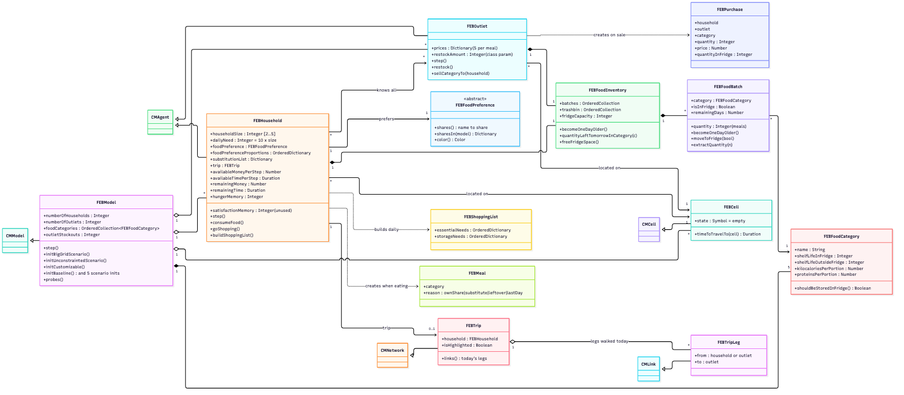

*Figure 1 — Main domain classes (`img/01-domain-classes.mmd`).*

| Kind | Class | Cormas superclass | Role |
|---|---|---|---|
| Model | `FEBModel` | `CMModel` | Holds the grid, the agents, the 5 food categories, the probes and the control method `step`. |
| Spatial entity | `FEBCell` | `CMCell` | A grid cell; converts distance to walking time (5 min per cell). |
| Agent | `FEBHousehold` | `CMAgent` | Located consumer: eats, plans, shops, stores food. |
| Agent | `FEBOutlet` | `CMAgent` | Located food retailer: restocks, sells, wastes unsold food. |
| Passive object | `FEBFoodCategory` | `Object` | One of 5 food groups with shelf lives and nutrient content. |
| Passive object | `FEBFoodBatch` | `Object` | A quantity of meals of one category with a remaining shelf life and a fridge flag. |
| Passive object | `FEBFoodInventory` | `Object` | Batches + trashbin + fridge capacity; used by households and outlets. |
| Passive object | `FEBShoppingList` | `Object` | Essential and storage needs per category, built daily by a household. |
| Passive object | `FEBPurchase` | `Object` | One sale/purchase (shared by buyer and seller records). |
| Passive object | `FEBMeal` | `Object` | One eaten portion with its category and reason. |
| Link | `FEBTripLeg` | `CMLink` | One walk of today's shopping trip, from the household or an outlet to the next outlet. |
| Network | `FEBTrip` | `CMNetwork` | The trip of one household: its legs of the day. Draws the path on the space view. |
| Preference | `FEBFoodPreference` + 3 subclasses | `Object` | A food preference profile: the share of each category and a colour. |
| Strategy | `FEBStrategy` + 4 subclasses | `Object` | Money and time reserve thresholds of a household. |
| Strategy | `FEBShoppingStrategy`, `FEBSimpleShoppingStrategy` | `Object` | Shopping trip algorithm. |
| Strategy | `FEBFoodConsumptionStrategy` + 2 subclasses | `Object` | What a household eats before its preference-based meals. |
| Record | `FEBHistory`, `FEBDay`, `FEBHouseholdDay`, `FEBOutletDay`, `FEBStockLevel` | `Object` | Per-step records used by indicators and dashboards. |

Cells, households and outlets are drawn with the image files `grass`, `household` and `outlet` of the model's image folder (there is no tileset class any more).

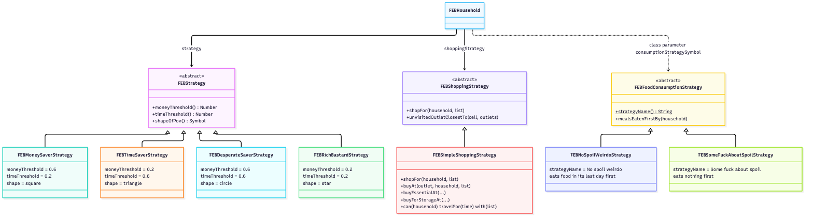

*Figure 2 — Strategy hierarchies (`img/02-strategy-classes.mmd`).*

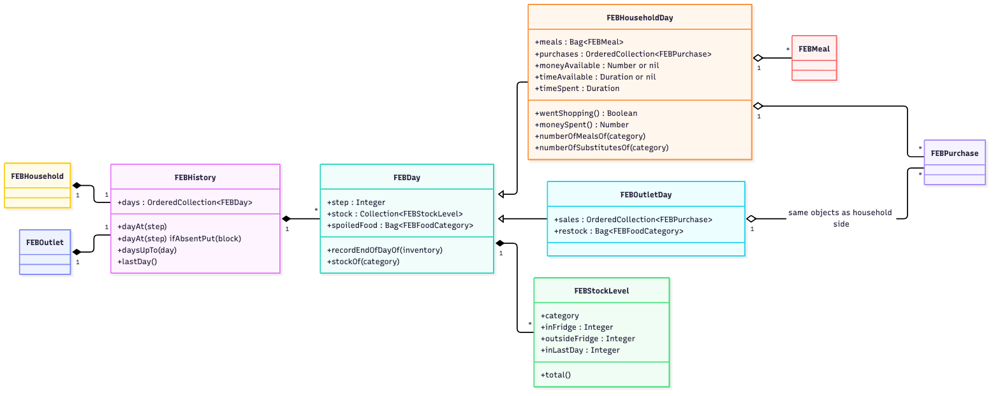

*Figure 3 — Records kept per time step (`img/03-history-classes.mmd`).*

### 2.2 Model (`FEBModel`)

| Variable | Type | Meaning | Value / source |
|---|---|---|---|
| `numberOfHouseholds` | Integer, parameter 0–1000 (default 2) | Households created at init | Overwritten by `initBigGridScenario` (100), `initUnconstraintedScenario` (2) and the scenario inits (100) |
| `numberOfOutlets` | Integer, parameter 0–1000 (default 1) | Outlets created at init | Overwritten by `initBigGridScenario` (40), `initUnconstraintedScenario` (20) and the scenario inits (10–100, §5.2) |
| `foodCategories` | OrderedCollection of 5 `FEBFoodCategory` | The food groups, in a fixed order | `initializeFoodCategories` |
| `outletStockouts` | Integer | Outlet × category pairs sold out once households have shopped, read by the "Outlet stockouts" probe | 0, then set in every `step` |
| `listOfOutlets` | — | Declared, never used | — |

### 2.3 Food categories (`FEBFoodCategory`)

| Name | Shelf life in fridge (days) | Shelf life outside (days) | kcal / portion | Protein g / portion | `shouldBeStoredInFridge` |
|---|---|---|---|---|---|
| Animal proteins | 5 | 2 | 250 | 37 | **yes** |
| Fruits and vegetables | 7 | 3 | 65 | 1.5 | no |
| Staple food | 30 | 30 | 260 | 4 | no |
| Dairy | 6 | 2 | 145 | 9 | **yes** |
| Processed food | 30 | 30 | 450 | 3 | no |

A category **should be stored in the fridge** when `shelfLifeOutsideFridge ≤ 2` **and** `shelfLifeInFridge > 2` (`FEBFoodCategory>>shouldBeStoredInFridge`). With the values above only *Animal proteins* and *Dairy* qualify; *Fruits and vegetables* (3 days outside) do not.

One unit of food everywhere in the model is **one portion = one meal**.

### 2.4 Households (`FEBHousehold`)

Instance state:

| Variable | Type | Meaning | Initial value |
|---|---|---|---|
| `householdSize` | Integer | Number of persons | `randomIntegerBetween: minHouseholdSize and: maxHouseholdSize` (2..5, see §5.3) |
| `dailyNeed` | Integer (meals/day) | Meals the household needs per day | `10 × householdSize` |
| `foodPreference` | `FEBFoodPreference` | The household's preference profile | Balanced diet at creation, then one of 3 profiles (§5.4) |
| `foodPreferenceProportions` | OrderedDictionary category → proportion | Share of the daily need wanted per category, sorted most preferred first (ties by name) | From `foodPreference` (§5.4); tests may set it directly |
| `substitutionList` | Dictionary category → category | Next category to eat/buy when one is missing | Same chain for every household (§7.3) |
| `trip` | `FEBTrip` | The network of the legs walked today (§2.9) | Created the first time the household shops |
| `strategy` | `FEBStrategy` | Money/time reserve thresholds | `MoneySaver`, then 50 % `MoneySaver` / 50 % `TimeSaver` |
| `shoppingStrategy` | `FEBShoppingStrategy` | Trip algorithm | `FEBSimpleShoppingStrategy` |
| `inventory` | `FEBFoodInventory` | Food at home (fridge + outside) and trashbin | Empty at creation; `dailyNeed` meals of the most preferred category, outside the fridge, given at init (§5.4) |
| `availableMoneyPerStep` | Number | Money available for food each step | Class parameter `availableMoneyPerStep` |
| `availableTimePerStep` | Duration | Time available for shopping each step | Class parameter `availableTimePerStep` hours |
| `remainingMoney` | Number | Money left during the current trip | Reset to `availableMoneyPerStep` when shopping starts; **not carried over** |
| `remainingTime` | Duration | Time left during the current trip | Reset to `availableTimePerStep` when shopping starts |
| `outlets` | Collection | Outlets the household knows | All outlets of the model |
| `hungerMemory` | Integer | Consecutive steps with fewer meals than the daily need | 0 (updated but not used by any decision) |
| `satisfactionMemory` | Integer | — | 2 (never used) |
| `history` | `FEBHistory` | One `FEBHouseholdDay` per step | empty |

Class-side parameters (shared by all households): `minHouseholdSize`, `maxHouseholdSize`, `availableMoneyPerStep`, `availableTimePerStep`, `fridgeCapacity`, `consumptionStrategySymbol` — see Appendix A.

### 2.5 Outlets (`FEBOutlet`)

| Variable | Type | Meaning | Initial value |
|---|---|---|---|
| `inventory` | `FEBFoodInventory` | Stock; fridge capacity 0 but fridge batches are added directly ("infinite fridge") | Restocked once at creation |
| `prices` | Dictionary category → price per meal | Selling price | **5** for every category (marked TODO) |
| `history` | `FEBHistory` | One `FEBOutletDay` per step | empty |
| `conventionalFoodInventory`, `healthyFoodInventory` | — | Declared, never used | — |

Class-side parameter: `restockAmount` (meals per restock).

### 2.6 Food batches and inventories

`FEBFoodBatch`: `category`, `quantity` (positive Integer, meals), `isInFridge` (Boolean), `remainingDays` (Number, can become fractional after moving out of / into the fridge).

- `isExpired` ⇔ `remainingDays ≤ 0`.
- `willExpireTomorrow` (food "in its last day") ⇔ `remainingDays ≤ 1`.

`FEBFoodInventory`: `batches`, `trashbin`, `fridgeCapacity` (meals; 0 by default). Batches of the same category, fridge state and remaining days are merged on `addBatch:`.

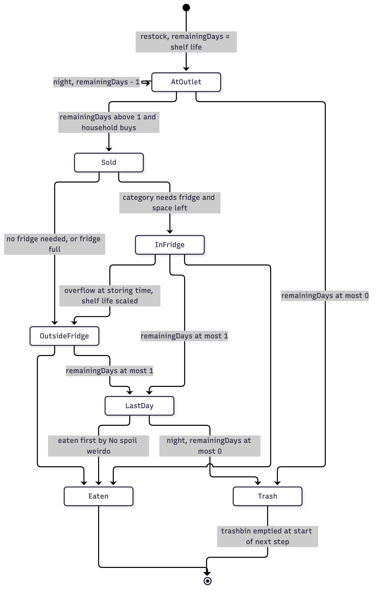

*Figure 4 — Life cycle of a batch of food (`img/12-food-batch-lifecycle.mmd`).*

### 2.7 Records (`FEBHistory`, `FEBDay`, …)

Every household and outlet keeps a `FEBHistory`: one record per Cormas time step, created on first use by `today` (`history dayAt: currentTimeStep ifAbsentPut: …`).

| Record | Holds |
|---|---|
| `FEBDay` (both) | `step`; `stock` (a `FEBStockLevel` per category held: in fridge, outside, in last day); `spoiledFood` (Bag category → meals spoiled that night) |
| `FEBHouseholdDay` | `meals` (Bag of `FEBMeal`), `purchases`, `moneyAvailable` and `timeAvailable` (nil if no trip), `timeSpent`, derived `moneySpent`, `wentShopping` |
| `FEBOutletDay` | `sales` (the same `FEBPurchase` objects as in the buyers' records), `restock` (Bag category → meals restocked) |

The outlets' restock at creation is recorded in the step‑0 record.

### 2.8 Spatial and temporal scales

| Scale | Value inferred from the code |
|---|---|
| Time step | **1 day** (shelf lives in days; households "eat in the morning and then consider buying food for the next day"; `availableTimePerStep` per step) |
| Simulation length | *(not set by the model; chosen in the Cormas simulation interface)* |
| Space | Regular grid of square cells, 8‑neighbourhood, closed (non‑toroidal) borders |
| Grid size | 30 × 30 (`initBigGridScenario` and the scenario inits), 5 × 5 (`initUnconstraintedScenario`), 6 × 6 (`initCustomizable`) |
| Cell size | Expressed only as walking time: **5 minutes per cell** (`FEBCell>>timeToTravelTo:`). The physical length is *(not inferable from the code)*. |
| Distance | Cormas `distanceTo:` on a closed 8‑neighbourhood grid = **Chebyshev distance** `max(|Δrow|, |Δcolumn|)` (diagonal moves cost one cell) |
| Food unit | 1 portion = 1 meal; a person needs 10 meals a day |
| Money unit | *(not inferable from the code)*; all prices are 5 units per meal |

### 2.9 Shopping trips (`FEBTrip`, `FEBTripLeg`)

Each walk of a shopping trip is a directed link, a `FEBTripLeg`: from the household's home, or from the outlet it has just left, to the next outlet visited (§7.4). The legs of one household belong to its trip, a `FEBTrip` network that knows its household and whether it is highlighted. Legs last one day: `FEBModel>>step` deletes them all before the households act, which also takes them out of their trips, while the trips themselves stay. Trips have no effect on the simulation: they record where households walked, for the new probes (§8.1) and for the space view (§8.2).

---

## 3. Process overview and scheduling

The Cormas control method is `FEBModel>>step` (pragma `<control>`). Within one time step:

1. Yesterday's **trip legs are deleted** (§2.9).
2. All **households**, in a **new random order**, execute `FEBHousehold>>step`.
3. The model **counts the outlet stockouts** (`countStockouts`): what households left, before outlets restock.
4. Then all **outlets**, in a **new random order**, execute `FEBOutlet>>step`.
5. Cormas then records the probes (§8) and announces `CMTimeStepEnded` (used by the dashboards).

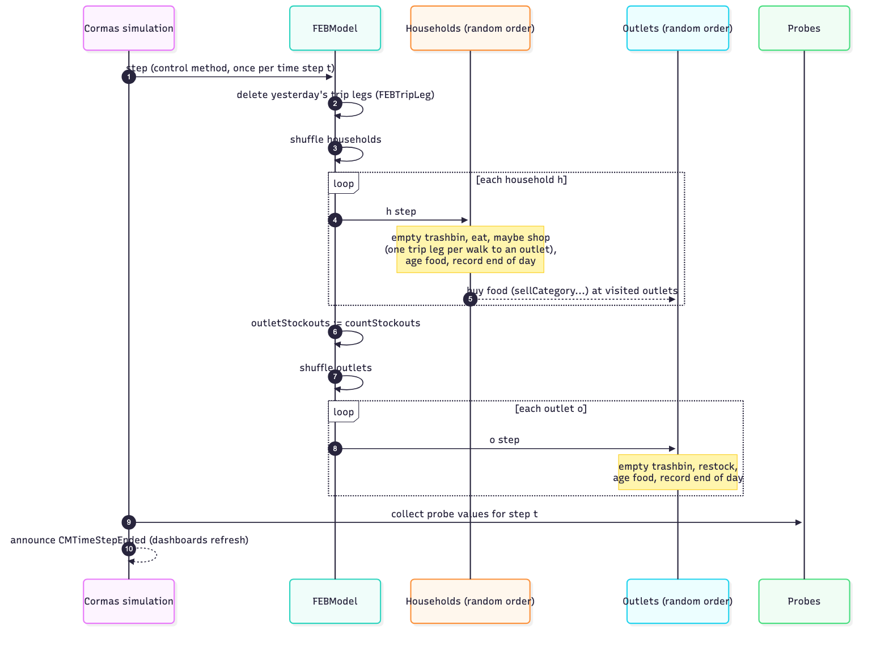

*Figure 5 — One time step (`img/05-model-schedule.mmd`).*

### 3.1 Household step

1. **Empty the trashbin** (food that spoiled the previous night is thrown away).
2. **Eat** (`consumeFood`, §7.1) up to `dailyNeed` meals; record them; update `hungerMemory`.
3. **Decide whether to shop** (`shouldGoShopping`, §7.2).
4. If so, **go shopping** (`goShopping`): reset money and time, **build a shopping list** (§7.3), **do the trip** (§7.4–7.5, one trip leg per walk), record money/time available and time spent, call `reconsiderPreference` (empty, TODO).
5. **Age the food** (`becomeOneDayOlder`): every batch loses one day; expired batches move to the trashbin.
6. **Record the end of the day** (stock levels and spoiled food).

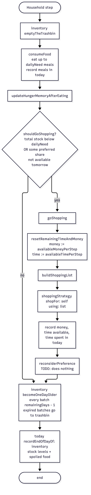

*Figure 6 — Household step (`img/06-household-step.mmd`).*

### 3.2 Outlet step

1. Empty the trashbin.
2. **Restock** (§7.7).
3. Age the food; expired batches move to the trashbin.
4. Record the end of the day.

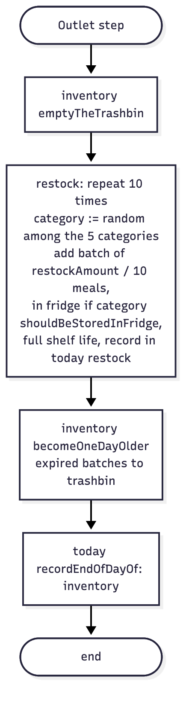

*Figure 7 — Outlet step (`img/11-outlet-step.mmd`).*

### 3.3 Consequences of the order

- Households act **before** outlets restock in the same step: a household buys from the stock left after the previous step's restock and ageing and after the households that went before it.
- Households compete on a **first‑come first‑served** basis, in a random order that changes every step.
- State is updated **asynchronously**: each household sees the outlet stock as modified by the households before it.

---

## 4. Design concepts

### 4.1 Basic principles

*(not inferable from the code — no theory or literature is referenced.)*

What the code implements: bounded‑rational, rule‑based households that plan purchases from preference shares, a fixed substitution chain, fridge constraints and money/time budgets, and buy greedily from the nearest outlets.

### 4.2 Emergence

From the code, these outputs are not imposed but result from interactions between households, outlets and budgets:

- distributions of satiety, caloric and protein adequacy across households;
- household and outlet food waste;
- the depletion of outlet stocks by competing households, and the distance households walk;
- the share of meals eaten as own share / substitutes / leftovers / last‑day food.

### 4.3 Adaptation

- Households adapt **what they eat** to what is in their inventory (own share → substitutes → any food left).
- They adapt **what they buy** to their stock (only what is missing for tomorrow and the next 5 days), to fridge space (perishable storage replaced by non‑perishable substitutes), to money (essential first, then storage within a reserve) and to time (stop when the next outlet is too far).
- They adapt **where they buy** to availability (go on to the next closest outlet when needs remain).
- `reconsiderPreference` exists but is empty: the model never changes preferences or strategies over time. A user can change them during a run with the household actions (`prefer…`, `be…Saver`); a new preference keeps the food already bought.

### 4.4 Objectives

Households implicitly try to (a) eat their daily need, (b) in their preferred proportions, (c) hold 5 extra days of food, (d) keep a money reserve (`moneyThreshold`) and a time reserve (`timeThreshold`) once tomorrow's essential needs are covered. No explicit utility function is computed.

### 4.5 Learning

None. `hungerMemory` is counted but not used; `satisfactionMemory` is never read.

### 4.6 Prediction

Households anticipate **tomorrow**: food that will be expired tomorrow (`remainingDays ≤ 1`) is not counted when deciding whether to shop or what to buy, and outlets do not sell it. Storage needs project the daily need over a **5‑day horizon**.

### 4.7 Sensing

- Households know **all outlets** and their exact distances (global knowledge).
- They learn an outlet's stock only by **visiting** it; there is no prior knowledge of availability or prices (prices are equal anyway).
- They know their own inventory exactly, including remaining shelf life and fridge use.

### 4.8 Interaction

- **Indirect, through outlet stocks**: food bought by one household is no longer available to the next (competition).
- **Direct exchange**: outlet → household sales (`FEBOutlet>>sellCategory:quantityUpTo:withMoneyUpTo:to:`), recorded as one shared `FEBPurchase`.
- No household–household or outlet–outlet interaction.

### 4.9 Stochasticity

| Where | Random process |
|---|---|
| Placement | Households and outlets on random empty cells, never two on the same cell; outlets only within the scenario's region when it has one (`initializeAgentsWithOutletsOn:`) |
| Household size | `(min + U[0,1) × (max − min)) rounded` (Cormas `randomIntegerBetween:and:`) |
| Preference profile | Households shuffled, then sent `preferMeatAndDairy`, `preferStapleAndProcessedFood`, `preferBalancedDiet` in turn |
| Strategy | Households shuffled; first 50 % MoneySaver, rest TimeSaver |
| Restock | 10 draws with replacement of a category, uniformly among the 5 |
| Scheduling | Households, then outlets, shuffled each step |
| Ties | Outlets at equal distance: order after `sorted:` (not random) |

All random draws use the Cormas random number generator, so a fixed seed reproduces a run (tested by `FEBModelTest>>testTheSameRandomSeedGivesTheSameSimulation`).

### 4.10 Collectives

None that affect the simulation. Households sharing a preference profile form groups only for observation (the `aspectFoodPreference:` colours). Each household's trip legs form a network (`FEBTrip`, §2.9), which is also only observed.

### 4.11 Observation

See §8.

---

## 5. Initialization

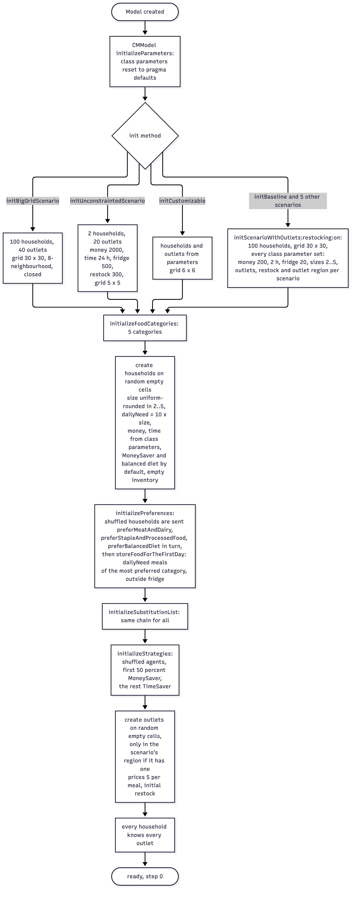

*Figure 8 — Initialization (`img/14-initialization.mmd`).*

### 5.1 Parameter reset

When a `FEBModel` is created, Cormas `initializeParameters` resets every parameter to its pragma default (Appendix A). Then the chosen `<init>` method runs and may overwrite some of them.

### 5.2 Scenarios (init methods)

| Init method | Grid | Households | Outlets | Parameters overwritten |
|---|---|---|---|---|
| `initBigGridScenario` | 30 × 30 | 100 | 40 | none |
| `initUnconstraintedScenario` | 5 × 5 | 2 | 20 | money 2000, time 24 h, fridge 500, restock 300 |
| `initCustomizable` | 6 × 6 | `numberOfHouseholds` | `numberOfOutlets` | none |

All grids: 8‑neighbourhood, closed; every init opens in `perspectiveSatiety`. Each init then calls `initializeFoodCategories` and `initializeAgents`.

**Experiment scenarios.** Six more inits, used in [`scenarios.md`](scenarios.md), share `initScenarioWithOutlets:restocking:on:`. It sets **every** class parameter (100 households of 2–5 people, money 200, 2 h, fridge 20, consumption strategy "No spoil weirdo"), creates a 30 × 30 grid and places the outlets with `initializeAgentsWithOutletsOn:`, only on the cells where the scenario's block answers true:

| Init method | Outlets | Placement | Restock per outlet |
|---|---|---|---|
| `initBaseline` | 40 | anywhere | 100 |
| `initAbundantSupply` | 40 | anywhere | 200 |
| `initScarceSupply` | 40 | anywhere | 60 |
| `initNearOutlets` | 100 | anywhere | 40 |
| `initUnequalDistance` | 40 | columns 1–15 | 100 |
| `initFoodDesert` | 10 | rows and columns 1–10 | 400 |

### 5.3 Households

`initializeAgents` creates `numberOfHouseholds` households on random empty cells. `FEBHousehold>>initialize`:

- `householdSize` = `(min + U[0,1)·(max − min)) rounded`. With the defaults 2 and 5: P(2) = 1/6, P(3) = 1/3, P(4) = 1/3, P(5) = 1/6 (mean 3.5).
- `dailyNeed = 10 × householdSize`.
- Money and time from the class parameters; `remainingMoney`/`remainingTime` set to them.
- Strategy MoneySaver and preference "balanced diet" (both temporary), an empty inventory with the class fridge capacity, `FEBSimpleShoppingStrategy`, empty history.
- The default preference needs the model's food categories, so households can only be created after `initializeFoodCategories` (Appendix C).

### 5.4 Preferences

Each preference profile is a subclass of `FEBFoodPreference`, which holds the share of each category by name (`shares`) and a colour, and each has a household `<action>` that sets it:

| Profile | Class | Action | Colour |
|---|---|---|---|
| A | `FEBMeatAndDairyPreference` | `preferMeatAndDairy` | red |
| B | `FEBStapleAndProcessedFoodPreference` | `preferStapleAndProcessedFood` | brown |
| C | `FEBBalancedDietPreference` | `preferBalancedDiet` | green |

`initializePreferences` shuffles the households and sends them the three actions in turn, by index modulo 3:

| Category | A "eats a lot of meat and dairy" | B "eats a lot of staple and processed food" | C "has a balanced diet" |
|---|---|---|---|
| Animal proteins | 0.35 | 0.10 | 0.20 |
| Fruits and vegetables | 0.15 | 0.10 | 0.30 |
| Staple food | 0.15 | 0.40 | 0.25 |
| Dairy | 0.30 | 0.10 | 0.15 |
| Processed food | 0.05 | 0.30 | 0.10 |

So the profiles are as equal in number as possible (A gets the extra household(s)). After its preference, each household gets its **first day of food** (`storeFoodForTheFirstDay`): one batch of `dailyNeed` meals of the **most preferred category, outside the fridge**, with that category's outside shelf life, so that it can eat on the first step. A preference set later, through an action, keeps the food already bought.

### 5.5 Substitution list

`initializeSubstitutionList` gives every household the same chain (Figure 9):

| Missing | Substitute |
|---|---|
| Animal proteins | Dairy |
| Dairy | Staple food |
| Fruits and vegetables | Staple food |
| Staple food | Processed food |
| Processed food | — (end of chain) |

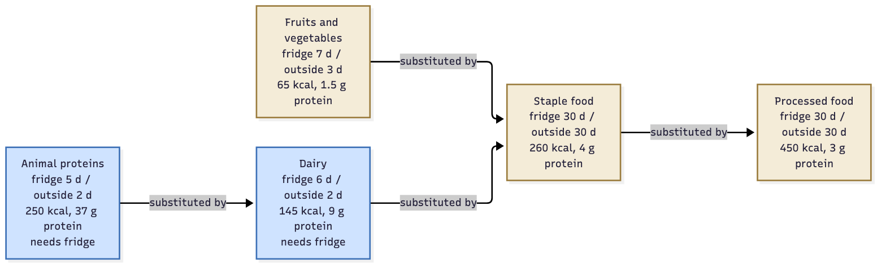

*Figure 9 — Food categories and substitution chain; blue = needs a fridge (`img/13-substitution-graph.mmd`).*

### 5.6 Strategies

`initializeStrategies` shuffles `self agents` (at that moment only households exist), makes the first `floor(0.5 × n)` **MoneySavers** and the rest **TimeSavers**. `DesperateSaver` and `RichBastard` exist and can be set with the `<action>` methods `beDesperateSaver` / `beRichBastard`, but no init assigns them.

### 5.7 Outlets

Created after the households, on random empty cells (only within the scenario's region, if it has one). `FEBOutlet>>initialize` sets every price to 5, creates an empty history and inventory, and **restocks once** (§7.7). Finally every household receives the collection of all outlets.

---

## 6. Input data

The model reads no external data files and no time series. All values are hard‑coded in the init methods or set through Cormas parameters.

---

## 7. Submodels

### 7.1 Eating (`FEBHousehold>>consumeFood`)

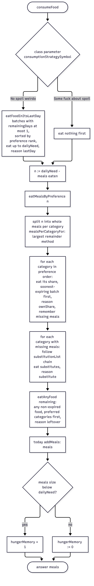

*Figure 10 — Consumption (`img/07-consumption.mmd`).*

1. **Consumption strategy first** (class parameter `consumptionStrategySymbol`):
   - *"No spoil weirdo"* (default, `FEBNoSpoilWeirdoStrategy`): `eatFoodInItsLastDay` — take every non‑expired batch with `remainingDays ≤ 1`, sorted by preference rank of its category, and eat from them until `dailyNeed` meals are eaten. Meals get the reason `#lastDay`.
   - *"Some fuck about spoil"* (`FEBSomeFuckAboutSpoilStrategy`): eats nothing first.
2. **Preference‑based meals** for the remaining `n = dailyNeed − eaten` (`eatMealsByPreference:`):
   1. **Split** `n` into whole meals per category with `mealsPerCategoryFor:` — exact shares `p_c × n`; floor them; give the leftover meals to the categories with the largest fractional parts (ties to the more preferred category). The result always sums to `n`.
   2. **Own share**: for each category in preference order, eat its share, **soonest‑expiring batches first** (`remainingDays` ascending). Reason `#ownShare`. Remember what is missing.
   3. **Substitutes**: for each category with missing meals, walk the substitution chain (`eat:substitutesFor:`) and eat as many of each successive substitute as available. Reason `#substitute`.
   4. **Leftovers**: if still short, eat any non‑expired food, categories by preference rank (categories outside the preferences last), soonest‑expiring first (`eatAnyFood:`). Reason `#leftover`.
3. Eating removes one unit at a time from the batch (`extractOneUnitFromBatch:`), deleting empty batches.
4. Meals are added to today's record. `hungerMemory` +1 if fewer than `dailyNeed` meals were eaten, else reset to 0.

Consequence: a household **eats less than its daily need only when it has no edible food left**, and it **never eats more** than its daily need.

### 7.2 Deciding to shop (`shouldGoShopping`)

A household goes shopping if **either**

- `inventory totalQuantity < dailyNeed` (all batches, including those in their last day), **or**
- for some preferred category, the quantity that will still be edible tomorrow (`quantityLeftTomorrowInCategory:`, excluding batches with `remainingDays ≤ 1`) is below that category's share of `dailyNeed`.

### 7.3 Building the shopping list (`buildShoppingList`)

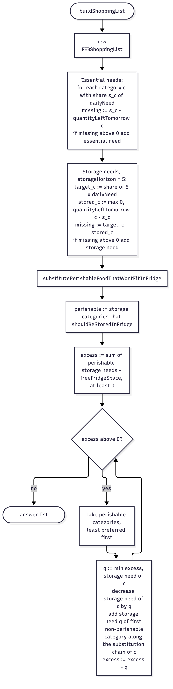

*Figure 11 — Shopping list (`img/08-shopping-list.mmd`).*

Let `s_c` be category c's share of `dailyNeed` (from `mealsPerCategoryFor:`) and `L_c` the quantity of c left tomorrow.

1. **Essential needs** (food for tomorrow): `E_c = s_c − L_c` if positive.
2. **Storage needs** (food for the following days), with `storageHorizon = 5`:
   - target `T_c` = c's share of `5 × dailyNeed`;
   - already stored beyond tomorrow `S_c = max(0, L_c − s_c)`;
   - `St_c = T_c − S_c` if positive.
3. **Fridge substitution** (`substitutePerishableFoodThatWontFitInFridge:`):
   - perishable storage categories = those with `shouldBeStoredInFridge` (Animal proteins, Dairy);
   - `excess = max(0, Σ St_perishable − freeFridgeSpace)` (free space now, before any purchase);
   - taking perishable categories **least preferred first**, move `q = min(excess, St_c)` meals from c to the **first non‑perishable category along c's substitution chain** (Animal proteins → Dairy → **Staple food**; Dairy → **Staple food**), until `excess` is 0.
   - Essential needs are never substituted.

The list keeps the insertion order, which is the preference order (most preferred first); purchases follow this order.

### 7.4 Shopping trip (`FEBSimpleShoppingStrategy>>shopFor:using:`)

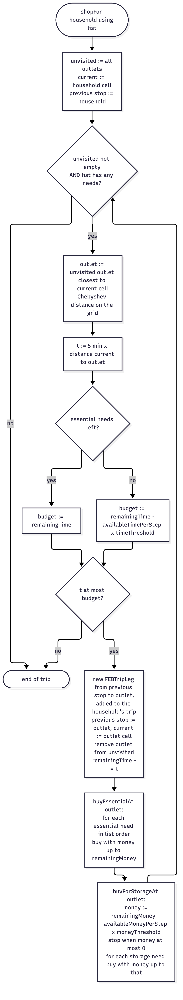

*Figure 12 — Shopping trip (`img/09-shopping-trip.mmd`).*

1. Start at the household's cell with all outlets unvisited.
2. While unvisited outlets remain **and** the list still has needs:
   1. Choose the **unvisited outlet closest to the current position** (greedy nearest neighbour, Chebyshev distance).
   2. Travel time `t = 5 min × distance`.
   3. Time budget: `remainingTime` if essential needs remain; otherwise `remainingTime − availableTimePerStep × timeThreshold`. If `t` exceeds the budget, the trip **ends**.
   4. Record the walk as a `FEBTripLeg` from the previous stop (home at first) to this outlet, in the household's trip (§2.9). Move there, mark it visited, `remainingTime −= t`.
   5. **Buy essentials** (each essential need in list order, money limit = `remainingMoney`), then **buy for storage** (money limit = `remainingMoney − availableMoneyPerStep × moneyThreshold`, recomputed after each category; stop as soon as it is ≤ 0).
3. Purchases reduce the list: essential need first, then storage need of the same category (`decreaseNeedOf:by:`).

The return trip home is not counted. Money and time left at the end of the day are lost (budgets reset at the next trip).

Strategy thresholds (`FEBStrategy` subclasses):

| Strategy | `moneyThreshold` (share of daily money kept from storage purchases) | `timeThreshold` (share of daily time kept once essentials are bought) | Shape |
|---|---|---|---|
| MoneySaver | 0.6 | 0.2 | square |
| TimeSaver | 0.2 | 0.6 | triangle |
| DesperateSaver | 0.6 | 0.6 | circle |
| RichBastard | 0.2 | 0.2 | star |

### 7.5 Selling and buying (`FEBOutlet>>sellCategory:quantityUpTo:withMoneyUpTo:to:`)

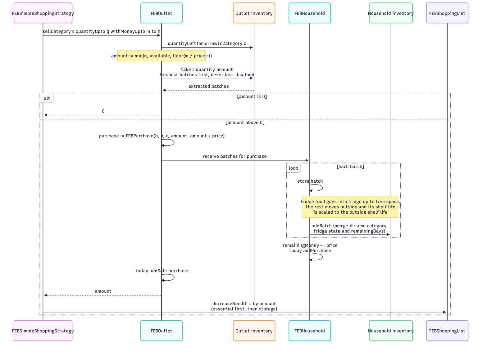

*Figure 13 — One purchase (`img/10-purchase-sequence.mmd`).*

1. Available = outlet stock of c that will still be good tomorrow (`remainingDays > 1`).
2. Amount = `min(requested, available, floor(money / price_c))`.
3. Take it from the **freshest batches first** (largest `remainingDays`), splitting batches as needed; food in its last day is never sold.
4. If the amount is 0, nothing happens. Otherwise a `FEBPurchase` is created with `price = amount × price_c`, the household **receives** the batches, pays, and records the purchase; the outlet records the same object as a sale.

### 7.6 Storing food at home (`FEBHousehold>>store:`)

- Batches bought keep the outlet's fridge flag and remaining days.
- A fridge batch goes into the fridge up to `freeFridgeSpace = max(0, fridgeCapacity − quantity in fridge)`. The rest is split off and **moved outside**: its remaining days are rescaled to keep the same fraction of shelf life, `remaining_out = shelfLifeOutside × remaining_in / shelfLifeInFridge` (`FEBFoodBatch>>moveToFridge:`). The value is kept exact (fractional), so moving back and forth never makes food fresher.
- Non‑fridge batches are stored outside.
- `quantityInFridge` of the purchase records how much went into the fridge.

### 7.7 Restocking (`FEBOutlet>>restock`)

Ten times: draw a category uniformly at random among the 5 (with replacement) and add a batch of `restockAmount / 10` meals, **in the fridge if the category should be stored in the fridge**, with full shelf life. Outlets have no capacity limit, no demand forecasting and no price changes. Restock is recorded in today's `FEBOutletDay`.

### 7.8 Ageing and spoilage (`FEBFoodInventory>>becomeOneDayOlder`)

Every batch loses 1 day; batches with `remainingDays ≤ 0` move to the trashbin. The trashbin is recorded at the end of the day (`spoiledFood`) and emptied at the start of the entity's next step, so the household probe of spoiled food shows **the food that spoiled during the last night**.

### 7.9 Indicators (household)

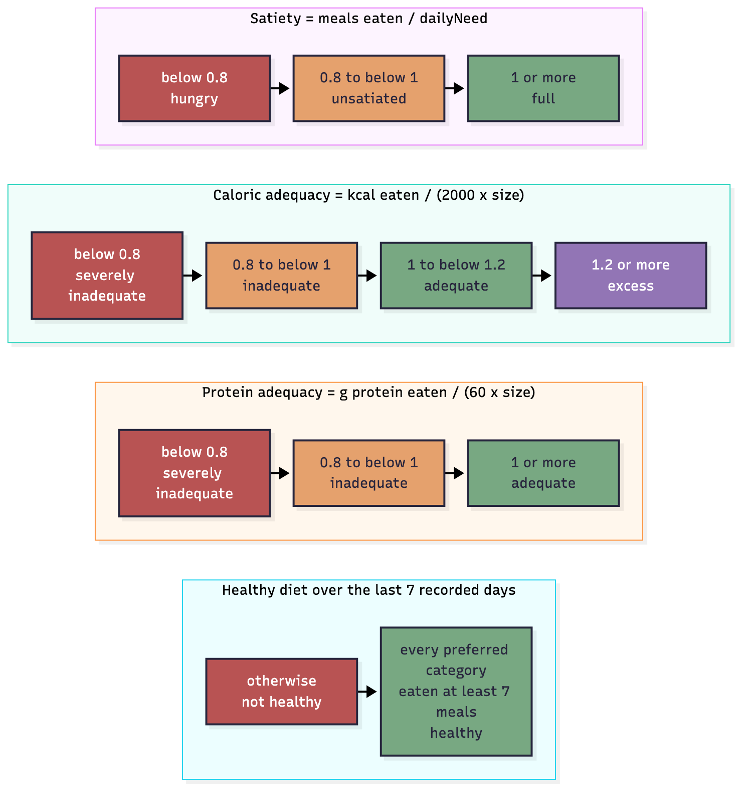

*Figure 14 — Indicators and their levels (`img/15-indicators.mmd`).*

All indicators are computed for a recorded day; the "current" value uses the last recorded day. Before any day is recorded, satiety, caloric and protein scores are 1 and the healthy diet is false.

| Indicator | Formula | Levels |
|---|---|---|
| Satiety | `meals eaten / dailyNeed` | < 0.8 hungry; < 1 unsatiated; ≥ 1 full |
| Caloric adequacy | `Σ kcal of meals / (2000 × householdSize)` | < 0.8 severely inadequate; < 1 inadequate; < 1.2 adequate; ≥ 1.2 excess |
| Protein adequacy | `Σ g protein of meals / (60 × householdSize)` | < 0.8 severely inadequate; < 1 inadequate; ≥ 1 adequate (no excess level) |
| Healthy diet | Over the last ≤ 7 recorded days up to the day: every category of the household's preferences (all 5) eaten ≥ 7 meals in total | healthy / not healthy |
| Preference difference (dashboard) | `meals of c / dailyNeed − p_c` | negative = ate less than preferred |

Notes: the healthy‑diet threshold (7 meals in 7 days) is **per household, not per person**; with fewer than 7 recorded days it still requires 7 meals.

Unused metrics on `FEBHousehold`: `averageDistanceTo5ClosestOutlets`, `averageDistanceToAllOutlets`, `numberOfOutletsWithin30Min`, `totalUsableFoodQuantity`.

---

## 8. Observation: probes, perspectives and dashboards

### 8.1 Probes (`FEBModel`, `<probeNamed:>`)

| Probe | Definition | Value at step 0 |
|---|---|---|
| Average satiety score | mean over households of `satietyScore` (0 if none) | 1 |
| Average caloric adequacy score | mean of `caloricAdequacyScore` | 1 |
| Average protein adequacy score | mean of `proteinAdequacyScore` | 1 |
| Number of full / unsatiated / hungry people | Σ `householdSize` of households at that satiety level | all full |
| Number of caloric adequate / excess / inadequate / severely inadequate people | Σ `householdSize` by caloric level | all adequate |
| Number of protein adequate / inadequate / severely inadequate people | Σ `householdSize` by protein level | all adequate |
| Amount of spoiled food in households | Σ meals in households' trashbins (spoiled last night) | 0 |
| Demand | Σ `dailyNeed` | — |
| Supply | Σ `restockAmount` of outlets (constant) | — |
| Total supply | Σ meals in outlets' inventories | — |
| Missing meals | Σ over households of `dailyNeed` − meals eaten that day | 0 |
| Average diet diversity | mean number of food categories eaten that day | 0 |
| Outlet stockouts | outlet × category pairs sold out once households have shopped (`outletStockouts`) | 0 |
| Minutes to the first outlet | mean walk from home to the first outlet, among households that reached one (first trip leg) | 0 |
| Outlets visited | mean number of trip legs, among households that reached an outlet | 0 |
| Shopping minutes | mean `timeSpent`, among households that went shopping | 0 |
| Share of budget spent | mean `moneySpent / moneyAvailable`, among households that went shopping | 0 |

The last seven probes were added for the experiment scenarios ([`scenarios.md`](scenarios.md) §2). There is still no probe for outlet waste, healthy diet or meal reasons; these exist only in the per‑entity records and dashboards.

### 8.2 Perspectives and aspects

Each entity class has **aspects** (methods with `<aspect>`, filling a look), and a **perspective** chooses the aspect of each class and which classes are hidden. The Aspects panel of a space view changes these choices.

| Perspective | Households shown with | Hidden |
|---|---|---|
| `perspectiveSatiety` | `aspectSatietyIndicator:` | `FEBTrip` |
| `perspectiveCaloricAdequacy` | `aspectCaloricAdequacyIndicator:` | `FEBTrip` |
| `perspectiveProteinAdequacy` | `aspectProteinAdequacyIndicator:` | `FEBTrip` |
| `perspectiveHealthyDiet` | `aspectHealthyDiet:` (green healthy / red not) | `FEBTrip` |

| Class | Aspects |
|---|---|
| `FEBCell` | default: the `grass` image, no border; `aspectWhite:` |
| `FEBOutlet` | default: the `outlet` image, size 0.8 |
| `FEBHousehold` | default: the `household` image, square, size `0.5 + 0.5 × (size − min)/(max − min)`; the four indicator aspects tint it with the level colour (60 % opacity); `aspectFoodPreference:` tints it with the preference colour (§5.4) |
| `FEBTrip` | default: orange path, 0.05 of a cell thick; red when highlighted, and every other trip hidden; `aspectHousehold:`: a colour per household (`colorGroupedBy:` its id), the same hiding |
| `FEBTripLeg` | always invisible: its trip draws the path |

Indicator colours (`CMColor`): red `#B90E0A` (hungry, severely inadequate), gold `#E5B80B` (unsatiated, inadequate), green `#00B44C` (full, adequate), purple `#660099` (excess); grey `#808080` before the first step. The strategy is no longer shown (all households are squares).

Trips are hidden in every perspective of the model and shown with the eye of `FEBTrip` in the Aspects panel. The household actions `highlightTrip` (highlight this household's trip, which hides the others) and `unhighlightTrip` (no trip highlighted, all shown) change what the trip aspects show; a highlight lasts until it is cleared. A network draws a line without arrowheads, so the direction of the walk is not shown.

### 8.3 Dashboards (`FE_Beta-Model-UI`)

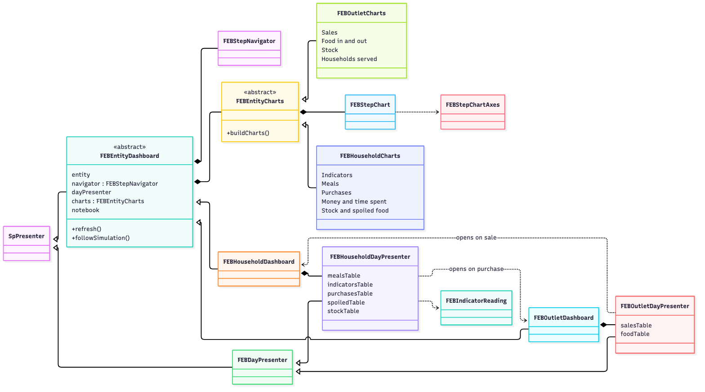

*Figure 15 — Dashboard classes (`img/04-ui-classes.mmd`).*

A **Dashboard** inspector tab on any household or outlet (also `FEBHouseholdDashboard openOn:` / `FEBOutletDashboard openOn:`). It has a step navigator and follows the simulation at each `CMTimeStepEnded` unless an earlier step is selected.

- **Household** — header: size, daily need, strategy. *Day* tab: meals per category (preference, eaten, difference, substitutes; red when below preference), indicators table, purchases (outlet, food, quantity, in fridge, price) with money/time spent, spoiled food, stock with fridge use. Chart tabs: *Indicators*, *Meals* (stacked, with daily need), *Purchases*, *Money and time spent* (shares), *Stock and spoiled food*.
- **Outlet** — header: restock amount. *Day* tab: sales with revenue and households served; per category price, restocked, sold, spoiled, stock in/out of fridge and in last day. Chart tabs: *Sales* (with revenue), *Food in and out*, *Stock* (with last‑day food), *Households served*.
- Double‑click or context menu on a purchase/sale opens the other party's dashboard on the same step.

---

## Appendix A — Parameters and hard-coded constants

### A.1 Cormas parameters

| Parameter | Owner | Type / range | Default | Overwritten by |
|---|---|---|---|---|
| `numberOfHouseholds` | `FEBModel` (instance) | Integer 0–1000 | 2 | BigGrid 100, Unconstrained 2, scenarios 100 |
| `numberOfOutlets` | `FEBModel` (instance) | Integer 0–1000 | 1 | BigGrid 40, Unconstrained 20, scenarios 10–100 |
| `availableMoneyPerStep` | `FEBHousehold` class | Integer 1–10000 | 100 | Unconstrained 2000, scenarios 200 |
| `availableTimePerStep` (hours) | `FEBHousehold` class | Float 0–24 | 2 | Unconstrained 24, scenarios 2 |
| `fridgeCapacity` (meals) | `FEBHousehold` class | Integer 0–10000 | 6 | Unconstrained 500, scenarios 20 |
| `minHouseholdSize` | `FEBHousehold` class | Integer | 2 | scenarios 2 |
| `maxHouseholdSize` | `FEBHousehold` class | Integer | 5 | scenarios 5 |
| `consumptionStrategySymbol` | `FEBHousehold` class | `#'No spoil weirdo'` / `#'Some fuck about spoil'` | `#'No spoil weirdo'` | scenarios `#'No spoil weirdo'` |
| `restockAmount` (meals per outlet per step) | `FEBOutlet` class | Integer 10–10000, step 10 | 200 | Unconstrained 300, scenarios 40–400 |

"Scenarios" are the six experiment inits of §5.2, which set every class parameter.

### A.2 Hard-coded constants

| Constant | Value | Where |
|---|---|---|
| Meals per person per day | 10 | `FEBHousehold>>initialize` |
| kcal reference per person per day | 2000 | `caloricAdequacyScoreOn:` |
| Protein reference per person per day | 60 g | `proteinAdequacyScoreOn:` |
| Level thresholds | 0.8, 1, 1.2 | `satietyLevelOf:`, `caloricAdequacyLevelOf:`, `proteinAdequacyLevelOf:` |
| Healthy diet window / threshold | 7 days / 7 meals per category | `isHavingHealthyDietOn:` |
| Storage horizon | 5 days | `addStorageNeedsToTheShoppingList:` |
| Walking time | 5 min per cell | `FEBCell>>timeToTravelTo:` |
| Price | 5 per meal, every category | `FEBOutlet>>initializePrices` |
| Restock batches | 10 random categories × `restockAmount/10` | `FEBOutlet>>restock` |
| Share of MoneySavers | 0.5 | `FEBModel>>initializeStrategies` |
| Fridge rule | outside ≤ 2 days and fridge > 2 days | `FEBFoodCategory>>shouldBeStoredInFridge` |
| Initial `satisfactionMemory` | 2 (unused) | `FEBHousehold>>initialize` |
| Food categories, substitution chain, strategy thresholds | see §2.3, §5.5, §7.4 | `FEBModel`, strategies |
| Preference shares and colours | see §5.4 | `shares`, `color` of the `FEBFoodPreference` subclasses |
| Trip thickness and colours | 0.05 of a cell; orange, red when highlighted | `FEBTrip>>aspectDefault:` |

---

## Appendix B — Values implied by the parameters

Simple consequences of the values above, computed by hand from the code (not model outputs).

### B.1 Nutrition of a full day eaten exactly in the preferred proportions

| Profile | kcal / meal | kcal / person / day | Caloric score | Protein g / meal | g / person / day | Protein score |
|---|---|---|---|---|---|---|
| A (meat & dairy) | 202.3 | 2 023 | 1.01 (adequate) | 16.6 | 166 | 2.77 |
| B (staple & processed) | 285.0 | 2 850 | 1.43 (**excess**) | 7.3 | 73 | 1.21 |
| C (balanced) | 201.0 | 2 010 | 1.01 (adequate) | 10.5 | 105 | 1.75 |

(Rounding of shares to whole meals changes these slightly per household size.)

### B.2 Money

Every meal costs 5, so a household can buy at most `availableMoneyPerStep / 5` meals per step. With the default 100 that is **20 meals**, while `dailyNeed` is 20–50. **Money is not scaled by household size**: with the defaults only 2‑person households can afford their daily need.

### B.3 Selling window at outlets (shelf life minus the restock night)

Food restocked at step t ages the same night, and outlets never sell food with `remainingDays ≤ 1`, so a batch can be sold on:

| Category | Stored at outlet | Days on sale |
|---|---|---|
| Fruits and vegetables | outside (3 d) | **1** (step t+1 only) |
| Animal proteins | fridge (5 d) | 3 |
| Dairy | fridge (6 d) | 4 |
| Staple food, Processed food | 30 d | 28 |

Fruits and vegetables reach the household with 2 days left and are in their last day the next morning.

### B.4 Fridge overflow

Fridge food that does not fit is moved outside and rescaled: animal proteins bought with 2–4 days left keep 0.8–1.6 days outside, i.e. they are in their last day the next morning or spoil the same night.

### B.5 Spatial range

With 2 hours and 5 min per cell a household can walk 24 cells (one way, Chebyshev). On a 30 × 30 grid this reaches most of the grid from a central cell.

---

## Appendix C — Behaviour of the implementation worth knowing

These are facts about the current code that matter when reading results. They are listed, not judged; recommendations are in `recommendations.md`.

1. **Household size distribution is not uniform**: rounding a uniform float gives the end values half the probability of the inner values (1/6, 1/3, 1/3, 1/6 for 2..5).
2. **The trip goes on when money is spent**: with essential needs left and no money, the household keeps walking to further outlets (buying nothing) until time runs out.
3. **Time is counted one way**; the walk home is free.
4. **Outlets sell the freshest food first** (LIFO), while households eat the oldest food first.
5. **Restock ignores demand**: categories are random; staple and processed food (30 days) accumulate in outlets over the first 30 steps.
6. **All prices are equal (5)**, so prices play no role in choices other than the total budget.
7. **The model never changes preferences, strategies or the substitution chain**; `reconsiderPreference` is a TODO. Only a user can, with the household actions.
8. **`hungerMemory` and `satisfactionMemory` have no effect.**
9. **`hasFoodForOneDay` counts food in its last day**, whereas the preferred-food check and the shopping list do not.
10. **The healthy diet indicator checks all 5 categories** (because every profile contains all 5), with an absolute threshold of 7 meals per week per household.
11. **Strategies are given to `self agents`**; this is correct only because outlets are created afterwards.
12. **The consumption strategy is a class parameter**: all households use the same one.
13. **`initUnconstraintedScenario` and the six scenario inits overwrite parameters**, so values changed in the Cormas interface for those parameters are ignored with those inits. The scenario inits set every class parameter, so no value is left over from an earlier run; the class parameters keep the scenario's values afterwards.
14. **The fridge substitution uses the free space before shopping**; essential perishable purchases made during the trip can still overflow the fridge.
15. **Ties between equidistant outlets** are broken by the order of the outlets collection.
16. **The "Supply" probe is constant** (`numberOfOutlets × restockAmount`).
17. Unused state: `FEBModel>>listOfOutlets`, `FEBOutlet>>conventionalFoodInventory`, `healthyFoodInventory`, `FEBCell>>state` (always `#empty`). Unused methods: `FEBHousehold>>shapeOfPovBasedOnStrategy` (the strategy is no longer drawn) and the distance metrics of §7.9.
18. **A household needs the model's food categories when it is created**, because `FEBHousehold>>initialize` sets the balanced‑diet preference. Creating a household in a model without food categories fails; this is why the 16 tests of `FEBHouseholdConsumptionTest` fail at commit `3460a98`.
19. **Trip legs are created and deleted every step** (about 750 a step in the 100‑household scenarios). Measured on 2026‑11‑18, this adds about 1.2 ms to a step of 175 ms.

---

## Appendix D — Code map and tests

### D.1 Packages

| Package | Content |
|---|---|
| `FE_Beta-Model` | Model, agents, food, preferences, strategies, trips, records |
| `FE_Beta-Model-UI` | Dashboards, day presenters, charts (Roassal), step navigator, inspector extensions |
| `FE_Beta-Model-Tests` | 10 test classes |
| `BaselineOfAmaeaModel` | Loads the three packages (Cormas is not in the baseline) |

### D.2 Where each process lives

| Process | Method |
|---|---|
| Schedule | `FEBModel>>step` |
| Init | `FEBModel>>initBigGridScenario`, `initUnconstraintedScenario`, `initCustomizable`, `initializeAgents`, `initializeAgentsWithOutletsOn:`, `initializeFoodCategories`, `initializePreferences`, `initializeSubstitutionList`, `initializeStrategies` |
| Scenario inits | `FEBModel>>initScenarioWithOutlets:restocking:on:`, `initBaseline`, `initAbundantSupply`, `initScarceSupply`, `initNearOutlets`, `initUnequalDistance`, `initFoodDesert` (protocol `scenarios`) |
| Preferences | `FEBHousehold>>prefer:`, `preferMeatAndDairy`, `preferStapleAndProcessedFood`, `preferBalancedDiet`, `storeFoodForTheFirstDay`; `FEBFoodPreference>>sharesIn:` |
| Trips | `FEBTrip`, `FEBTripLeg`; `FEBHousehold>>trip`, `highlightTrip`, `unhighlightTrip`; deleted in `FEBModel>>step` |
| Household step | `FEBHousehold>>step` |
| Eating | `consumeFood`, `eatFoodInItsLastDay`, `eatMealsByPreference:`, `eat:mealsOf:as:`, `eat:substitutesFor:`, `eatAnyFood:`, `mealsPerCategoryFor:` |
| Shopping decision | `shouldGoShopping`, `hasFoodForOneDay`, `hasPreferredFoodForOneDay` |
| Shopping list | `buildShoppingList`, `addEssentialMealsToTheShoppingList:`, `addStorageNeedsToTheShoppingList:`, `substitutePerishableFoodThatWontFitInFridge:`, `findNonPerishableSubstitutionFor:` |
| Trip | `FEBSimpleShoppingStrategy>>shopFor:using:`, `can:travelFor:with:`, `buyAt:for:using:`, `buyEssentialAt:…`, `buyForStorageAt:…` |
| Sale | `FEBOutlet>>sellCategory:quantityUpTo:withMoneyUpTo:to:`, `take:quantityUpTo:withMoneyUpTo:`, `take:quantity:` |
| Storage | `FEBHousehold>>receive:for:`, `store:`; `FEBFoodBatch>>moveToFridge:` |
| Restock | `FEBOutlet>>restock` |
| Ageing | `FEBFoodInventory>>becomeOneDayOlder`, `removeExpiredBatched` |
| Indicators | `FEBHousehold>>satietyScoreOn:`, `caloricAdequacyScoreOn:`, `proteinAdequacyScoreOn:`, `isHavingHealthyDietOn:`, `…LevelOf:` |
| Probes | `FEBModel` methods with `<probeNamed:color:>`; helpers in protocol `probes - private`; `FEBHousehold>>missingMeals`, `dietDiversity`; `FEBOutlet>>isOutOf:` |

### D.3 What the tests establish

The test suite (143 tests) states the intended behaviour:

- **Food** (`FEBFoodBatchTest`, `FEBFoodInventoryTest`): batches are never empty; food lasts longer in the fridge; moving food never makes it fresher; spoiled food goes to the trashbin and is counted per category.
- **Eating** (`FEBHouseholdConsumptionTest`): proportions are respected; meals add up to the daily need; soonest‑expiring first; substitutes follow the list; leftovers rather than hunger; never eats spoiled food; behaviour of both consumption strategies.
- **Shopping** (`FEBShoppingTripTest`, `FEBHouseholdTest`, `FEBShoppingListTest`): closest outlet first; moves on when an outlet is empty; time limit; walks further for today's food than for storage; money reserve for storage; never overspends; buys most preferred first when money is short; unspent money is not saved; fridge is never overfilled; strategy comparisons (MoneySaver vs TimeSaver, DesperateSaver vs RichBastard).
- **Outlets** (`FEBOutletTest`): freshest first, never last‑day food, never more than stock or money allows, food and money only change hands.
- **Model** (`FEBModelTest`): preferences sum to 1; households are shared equally among the three preferences; half the households save money; sizes within limits; 10 meals per person; every fridge food has a non‑fridge substitute; sold = bought; days add up; same seed → same simulation.
- **Preferences** (`FEBHouseholdTest`): changing a household's preference keeps its food.
- **Trips** (`FEBShoppingTripTest`): the trip goes from home to each visited outlet in turn; an outlet out of reach is not on it; the legs make up the household's trip; a new day starts without yesterday's trips; highlighting one trip unhighlights the others, and unhighlighting leaves none highlighted.
- **Probes** (`FEBShoppingTripTest`, protocol `tests - probes`): missing meals, diet diversity, minutes to the first outlet, shopping minutes, outlets visited, share of budget spent, stockouts.
- **Scenarios** (`FEBScenarioTest`): supply against demand in the baseline, scarce and abundant scenarios; the proximity scenarios keep the baseline supply; outlets are in their region; 100 households with a preference each.
