# AMAEA model — First scenario experiments

Companion to [`odd.md`](odd.md) and [`recommendations.md`](recommendations.md). Two of the four accessibility dimensions of the experimental design are tested here, **availability** (§2.1 of the design) and **proximity** (§2.2), against a **baseline** (§1). They were chosen because they can be run meaningfully with the current implementation. Affordability and convenience were left out for now:

- **Affordability:** all foods cost the same (5 per meal), so a tighter budget only lowers quantity. It cannot cause the "substitution toward cheaper food groups" that the design asks about.
- **Convenience:** the exploratory runs found that fridge capacity has little effect while households shop every day.

Code: commit `637fbbd` of `amaea-model`, plus the uncommitted scenario inits and probes described below. **10 random seeds per scenario, 90 steps per run, measures averaged over steps 31–90** (the first 30 steps are a warm‑up, the shelf life of staple and processed food).

---

## 0. Summary

| | Baseline | Abundant | Scarce | Near outlets | Unequal distance | Food desert |
|---|---|---|---|---|---|---|
| Supply ÷ demand | 1.13 | 2.27 | 0.68 | 1.13 | 1.13 | 1.13 |
| Satiety | **0.91** | 0.96 | **0.68** | 0.91 | 0.87 | 0.87 |
| Missing meals (share of demand) | 11 % | 5 % | **34 %** | 10 % | 15 % | 14 % |
| Diet diversity (categories / day) | 4.3 | 4.4 | **3.4** | 4.5 | 4.1 | 3.9 |
| Households with satiety < 0.8 | 20 % | 7 % | **71 %** | 22 % | 29 % | 26 % |
| Correlation: walk to nearest outlet × satiety | −0.08 | 0.02 | −0.10 | −0.07 | **−0.66** | **−0.54** |

1. **Availability has a strong effect.**
   - Scarce supply (0.68 × demand) lowers satiety from 0.91 to 0.68, triples missing meals, and loses about one food category a day.
   - Outlets run out of almost everything: 93 % of outlet × category pairs are sold out after shopping.
   - Abundant supply (2.3 × demand) gains little over the baseline (0.96), and doubles household waste.
2. **Proximity matters only when outlets are unevenly placed.**
   - Spreading the same supply over 100 outlets (near outlets) changes nothing for diets. It fragments stock instead: households visit 10 outlets a day instead of 6.6, and two thirds of outlet × category pairs are sold out.
   - When outlets are concentrated (unequal distance, food desert), distance becomes the main driver of differences between households (r = −0.66 and −0.54). Households more than 45 minutes (unequal) or 90 minutes (desert) from an outlet reach a satiety of only 0.67, and eat about one food category less.
3. **Household size dominates every scenario.** Money is per household (200), and a 5‑person household's day costs 250. So 5‑person households stay hungry even with abundant supply (satiety 0.80, against 1.00 for the others). This mixes budget with size in every result (see `recommendations.md` §2, item 1.1).

---

## 1. Scenarios

All scenarios share these settings and change only the outlets:

| Setting | Value |
|---|---|
| Grid | 30 × 30, 8 neighbours, closed |
| Households | 100, alone on random cells, 2–5 people (mean 3.53, so demand is ≈ 3 530 meals/day) |
| Budget | 200 per household per day (`availableMoneyPerStep`) |
| Time | 2 h per day (`availableTimePerStep`). Walking costs 5 min per cell, and the walk home is not counted |
| Fridge | 20 meals per household |
| Consumption strategy | "No spoil weirdo" (eat food in its last day first) |
| Preferences | shared equally among the three profiles (`initializePreferences`) |
| Prices | 5 per meal, every category and outlet |

| Init method | Dimension | Outlets | Placement | Restock per outlet | Supply (meals/day) |
|---|---|---|---|---|---|
| `initBaseline` | — | 40 | anywhere | 100 | 4 000 |
| `initAbundantSupply` | availability | 40 | anywhere | 200 | 8 000 |
| `initScarceSupply` | availability | 40 | anywhere | 60 | 2 400 |
| `initNearOutlets` | proximity | 100 | anywhere | 40 | 4 000 |
| `initUnequalDistance` | proximity | 40 | west half (columns 1–15) | 100 | 4 000 |
| `initFoodDesert` | proximity | 10 | north‑west 10 × 10 corner | 400 | 4 000 |

- Each init sets **every** class parameter, so nothing is left over from an earlier run (`recommendations.md` §2, item 1.4). They share `FEBModel>>initScenarioWithOutlets:restocking:on:`.
- Outlets are placed by `initializeAgentsWithOutletsOn:`. `initializeAgents` now uses it with no constraint and draws exactly the same random numbers as before.
- The same seed gives the same households and household positions in every scenario. Seeds 1–10 are therefore paired: the three availability scenarios also share their outlet positions.

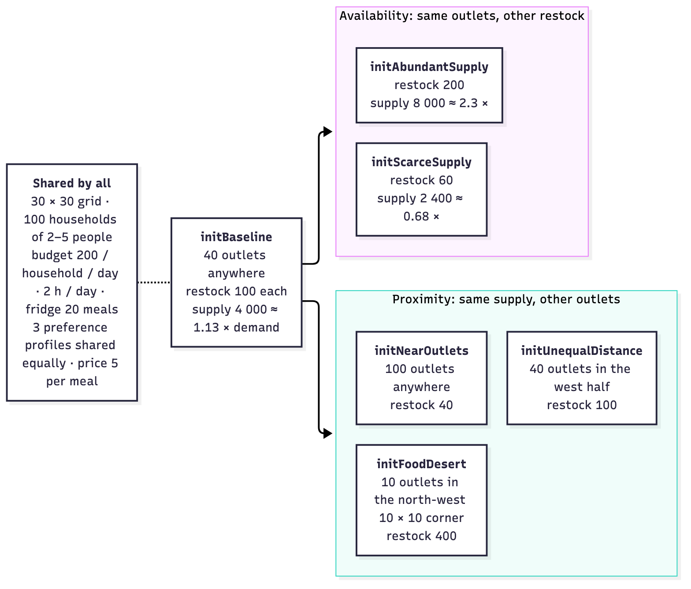

*Figure 24 — The scenarios: the baseline, and the outlets that the availability and proximity scenarios change (`img/24-scenario-design.mmd`).*

The four outlet layouts are shown below after 31 steps with seed 1, in the Satiety perspective. Households are coloured by their satiety that day: green when full, gold when unsatiated (0.8 to 1), red when hungry (below 0.8). The availability scenarios have the same layout as the baseline.

| | |
|---|---|
| 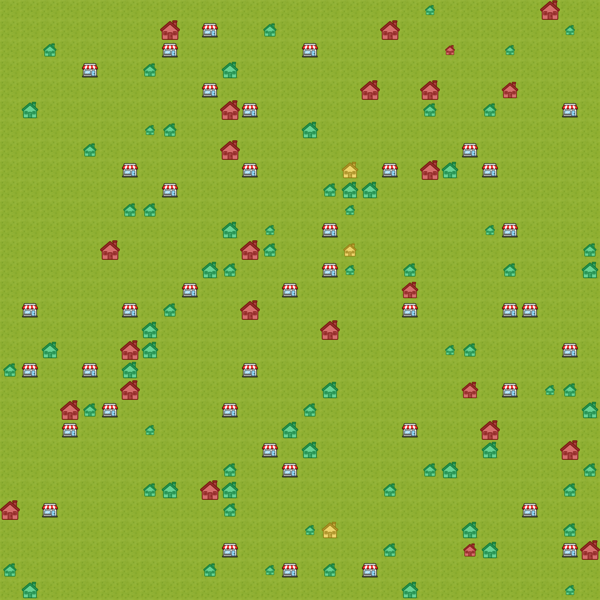 | 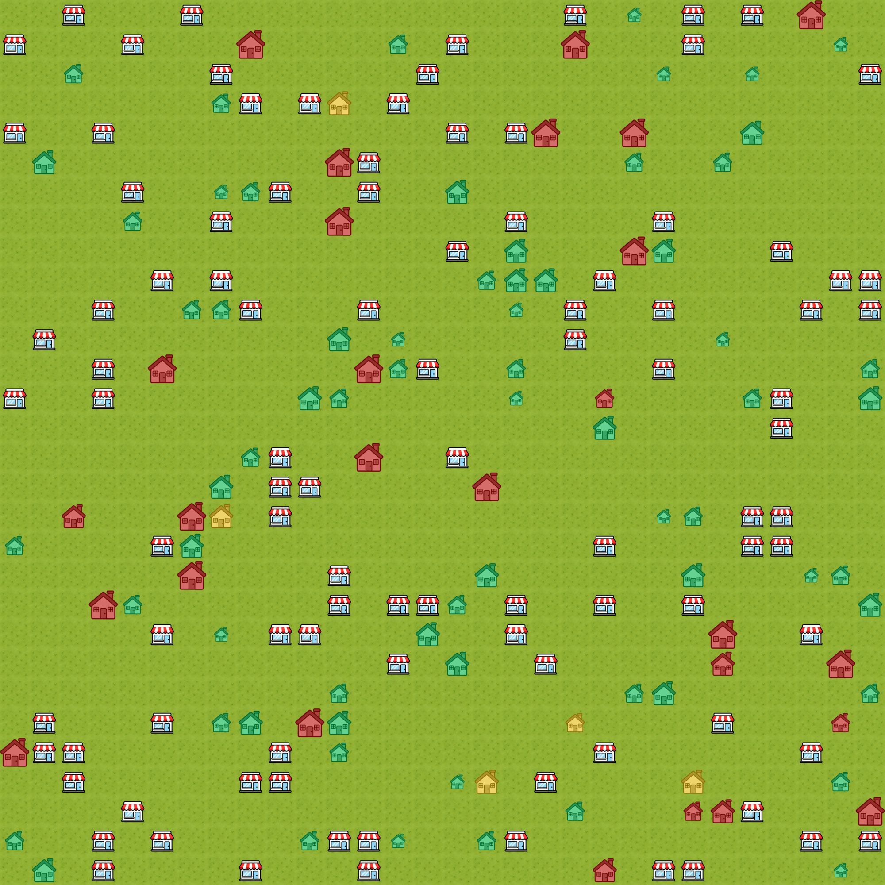 |
| *Figure 16 — Baseline: 40 outlets anywhere.* | *Figure 17 — Near outlets: 100 outlets anywhere.* |
| 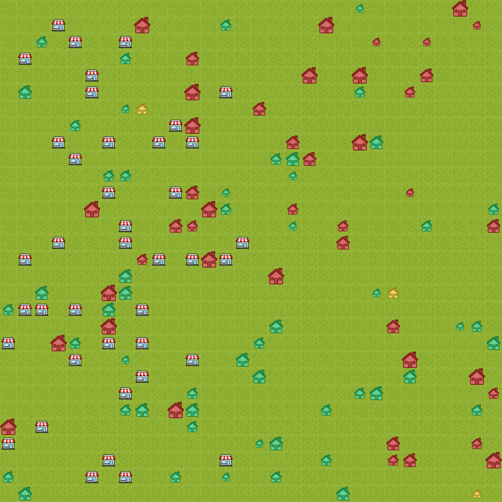 | 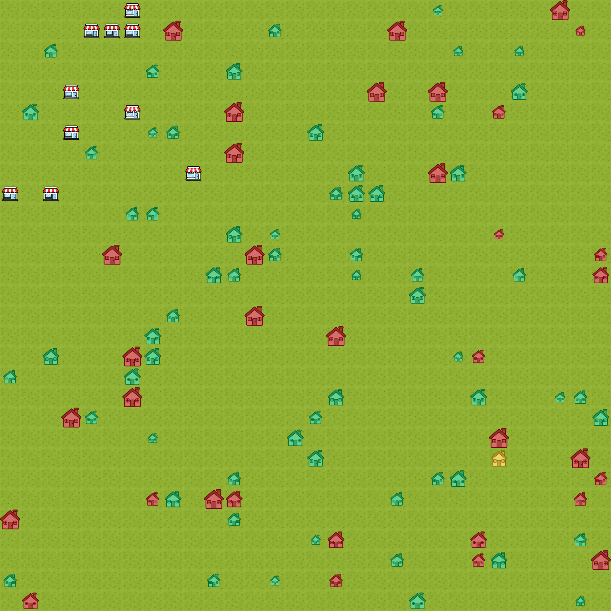 |
| *Figure 18 — Unequal distance: 40 outlets in the west half.* | *Figure 19 — Food desert: 10 outlets in the north‑west corner.* |

### Reproduce

```smalltalk
| sim model |
sim := CMSimulation for: FEBModel new.
sim
	activeInitSelector: #initFoodDesert;
	activeControlSelector: #step;
	randomSeed: 1;
	hasFixedRandomSeed: true;
	initializeSimulation.
model := sim cormasModel.
90 timesRepeat: [ sim runStep ].
model averageSatietyScore
```

A 90‑step run takes about 17 s (25 s with 100 outlets). The 60 runs took about 25 minutes.

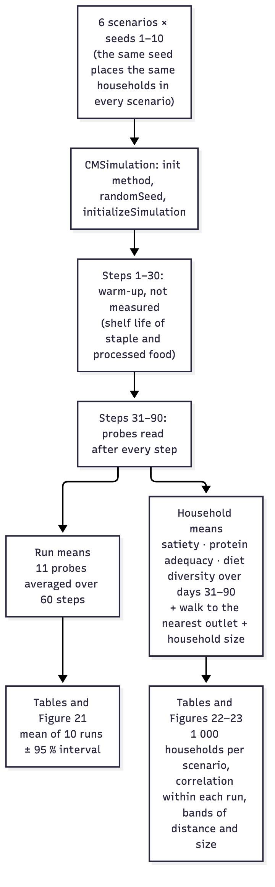

*Figure 26 — How each run is measured (`img/26-experiment-protocol.mmd`).*

---

## 2. New probes

They were needed to read availability and proximity directly. All count the latest day.

| Probe | Method | Meaning |
|---|---|---|
| Missing meals | `FEBModel>>missingMeals` | Σ over households of daily need − meals eaten |
| Average diet diversity | `averageDietDiversity` | food categories eaten by a household, out of 5 |
| Outlet stockouts | `outletStockouts` | outlet × category pairs sold out once households have shopped, before outlets restock |
| Minutes to the first outlet | `averageMinutesToFirstOutlet` | walk from home to the first outlet visited, among households that reached one |
| Outlets visited | `averageNumberOfOutletsVisited` | legs of today's trip (`FEBTrip`), among households that reached an outlet |
| Shopping minutes | `averageShoppingMinutes` | time walked, among households that went shopping (out of 120) |
| Share of budget spent | `averageShareOfBudgetSpent` | money spent ÷ money available, among households that went shopping |

Stockouts are counted inside `FEBModel>>step`, between the households' and the outlets' steps, and kept in a new `outletStockouts` slot. The probes are tested in `FEBShoppingTripTest` (protocol `tests - probes`) and the scenarios in `FEBScenarioTest`.

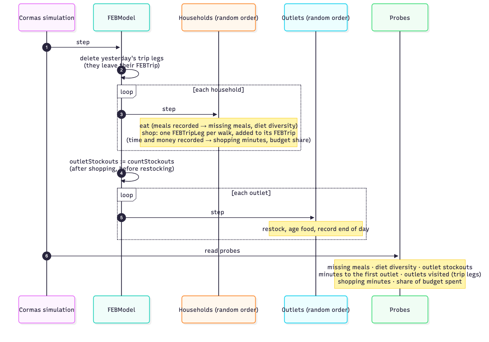

*Figure 25 — One step of the model and what each new probe reads (`img/25-scenario-step-measures.mmd`).*

---

## 3. Results

Means over 10 seeds, ± half‑width of the 95 % interval.

| Measure | Baseline | Abundant | Scarce | Near outlets | Unequal | Desert |
|---|---|---|---|---|---|---|
| Satiety | 0.913 ±0.018 | 0.964 ±0.006 | 0.683 ±0.014 | 0.914 ±0.012 | 0.867 ±0.024 | 0.874 ±0.038 |
| Caloric adequacy | 1.03 ±0.02 | 1.04 ±0.01 | 0.79 ±0.02 | 1.04 ±0.01 | 0.98 ±0.03 | 0.99 ±0.04 |
| Protein adequacy | 1.70 ±0.04 | 1.84 ±0.02 | 1.24 ±0.03 | 1.69 ±0.03 | 1.60 ±0.05 | 1.62 ±0.07 |
| Missing meals / day | 374 ±73 | 180 ±31 | 1 201 ±70 | 367 ±41 | 531 ±89 | 500 ±122 |
| Diet diversity | 4.29 ±0.06 | 4.44 ±0.04 | 3.35 ±0.05 | 4.50 ±0.06 | 4.07 ±0.11 | 3.91 ±0.17 |
| Outlet stockouts | 121 / 200 | 25 / 200 | 186 / 200 | 336 / 500 | 122 / 200 | 32 / 50 |
| Minutes to first outlet | 11.4 ±0.7 | 11.4 ±0.7 | 11.4 ±0.7 | 7.4 ±0.3 | 24.3 ±1.3 | 59.8 ±2.7 |
| Outlets visited / trip | 6.6 ±0.2 | 5.8 ±0.2 | 7.4 ±0.2 | 10.3 ±0.2 | 8.1 ±0.2 | 4.9 ±0.4 |
| Shopping minutes (of 120) | 89 ±1 | 77 ±1 | 100 ±1 | 95 ±2 | 95 ±2 | 100 ±2 |
| Share of budget spent | 0.81 ±0.02 | 0.87 ±0.01 | 0.58 ±0.01 | 0.80 ±0.02 | 0.77 ±0.03 | 0.78 ±0.04 |
| Household waste (meals / day) | 45 ±6 | 90 ±12 | 6 ±2 | 27 ±6 | 43 ±9 | 60 ±10 |

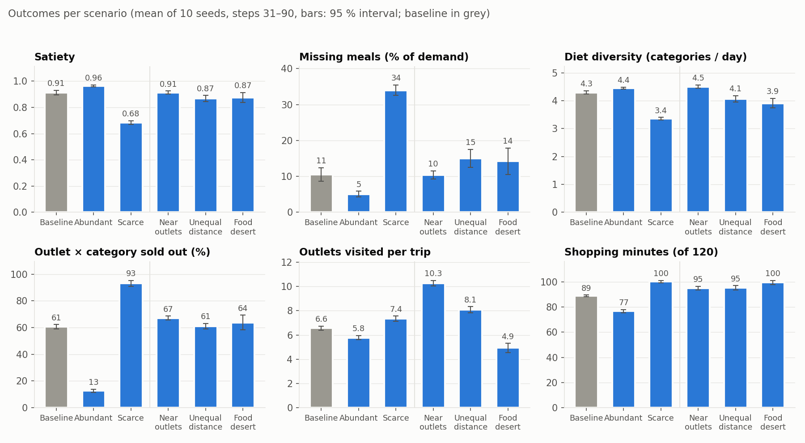

*Figure 21 — Six measures per scenario. Missing meals are shown as a share of demand, and stockouts as a share of outlet × category pairs, so that scenarios with different numbers of outlets can be compared. Data: the 60 runs of §3.*

### 3.1 By distance to the nearest outlet

Household means over steps 31–90, pooled over the 10 seeds (1 000 households per scenario). Each cell gives the number of households, their satiety, and their diet diversity.

| Nearest outlet | Baseline | Near outlets | Unequal | Desert |
|---|---|---|---|---|
| 0–15 min | 637 · 0.92 · 4.3 | 932 · 0.92 · 4.5 | 470 · 0.94 · 4.4 | 98 · 0.97 · 4.3 |
| 15–45 min | 363 · 0.90 · 4.2 | 68 · 0.90 · 4.4 | 306 · 0.90 · 4.2 | 209 · 0.96 · 4.3 |
| 45–90 min | — | — | 224 · **0.67** · **3.2** | 457 · 0.92 · 4.1 |
| over 90 min | — | — | — | 236 · **0.67** · **3.0** |

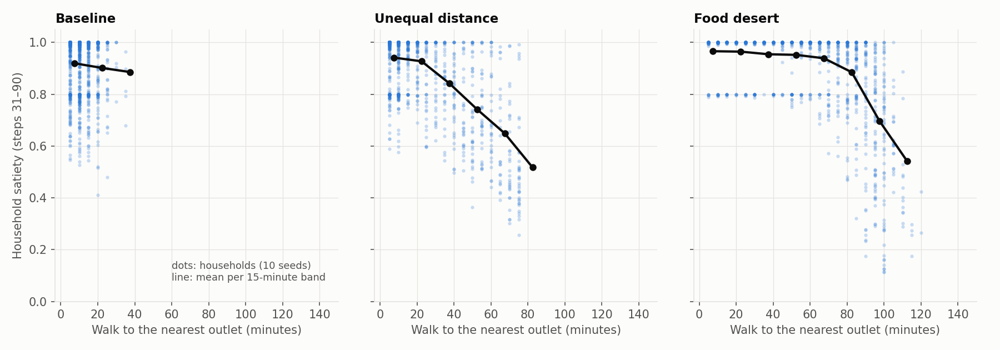

*Figure 22 — Each household's satiety against its walk to the nearest outlet. In the baseline every household has an outlet within 45 minutes, and distance explains almost nothing. With concentrated outlets, satiety drops in the far bands.*

### 3.2 By household size

Satiety, with protein adequacy in parentheses.

| Size | Baseline | Abundant | Scarce | Unequal | Desert |
|---|---|---|---|---|---|
| 2 | 0.98 (1.71) | 1.00 (1.77) | 0.81 (1.40) | 0.94 (1.65) | 0.93 (1.61) |
| 3 | 0.96 (1.81) | 1.00 (1.90) | 0.74 (1.35) | 0.90 (1.68) | 0.92 (1.69) |
| 4 | 0.93 (1.73) | 1.00 (1.89) | 0.65 (1.20) | 0.88 (1.62) | 0.88 (1.65) |
| 5 | **0.74** (1.42) | **0.80** (1.66) | **0.53** (0.96) | 0.71 (1.35) | 0.73 (1.42) |

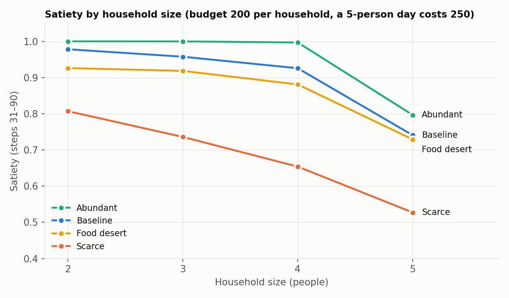

*Figure 23 — Satiety by household size in four scenarios. The break at 5 people appears even with abundant supply: it is the budget of 200 per household, not the food environment.*

---

## 4. Reading the results against the design

### Baseline (design §1)

As intended, most households meet their needs (satiety 0.91, caloric adequacy 1.03), while inequalities remain: 20 % of households have a satiety below 0.8.

Those inequalities come almost entirely from **household size**, not from distance (r = −0.08). A 5‑person household needs 250 a day, and its budget is 200. Distance, preferences and storage hardly show.

Even in the baseline, **61 % of outlet × category pairs are sold out after shopping**. Outlets restock random categories (10 batches out of 5 categories), so a household often has to visit several outlets to find what it wants: 6.6 outlets and 89 of its 120 minutes a day.

### Availability (design §2.1)

- **Scarce supply** behaves as the design expects:
  - Unmet demand rises to a third of needs. Diversity falls by about one category, and caloric adequacy falls below 1.
  - Households spend only 58 % of their budget, because there is nothing left to buy. They walk longer (100 min) and visit more outlets (7.4) looking for food.
  - Competition is visible in the stockouts (93 %). Large households suffer most (satiety 0.53, and protein below 1, the only case where it is).
  - Distance plays almost no part (r = −0.10). With outlets spread everywhere, a household's order in the day (random) and its size matter more than its position.
- **Abundant supply** brings satiety close to 1 for every household of 2–4 people. The remaining hunger is the budget of 5‑person households. Household waste doubles (90 meals a day, against 45).

### Proximity (design §2.2)

- **Near outlets:** more outlets for the same supply does *not* improve diets. Each outlet stocks only 40 meals in random categories, so stock is fragmented: households visit 10 outlets a day, walk longer (95 min), and find 67 % of outlet × category pairs sold out. In this model, "more outlets" is only an advantage if each outlet keeps a useful stock.
- **Unequal distance and food desert** produce the expected gradient. Distance becomes the main source of inequality between households:
  - Households in the far band reach a satiety of 0.67 and eat about one food category less: 45–90 min in the unequal scenario, over 90 min in the desert.
  - Households near the concentrated outlets do *better* than in the baseline (0.94 and 0.97), because each of those outlets holds more stock.
  - The averages over all households hide this (0.87, against 0.91 for the baseline).
- **Why far households fail:**
  - They arrive with less time left to look further, and they shop in a random order with households near the outlets, which may already have taken the food.
  - The walk home is not counted, so a household 100 minutes away can still reach the corner and shop there for 20 minutes.
  - With the walk home counted, the far band of the desert would lose access entirely. That may be closer to what the design means by a food desert.

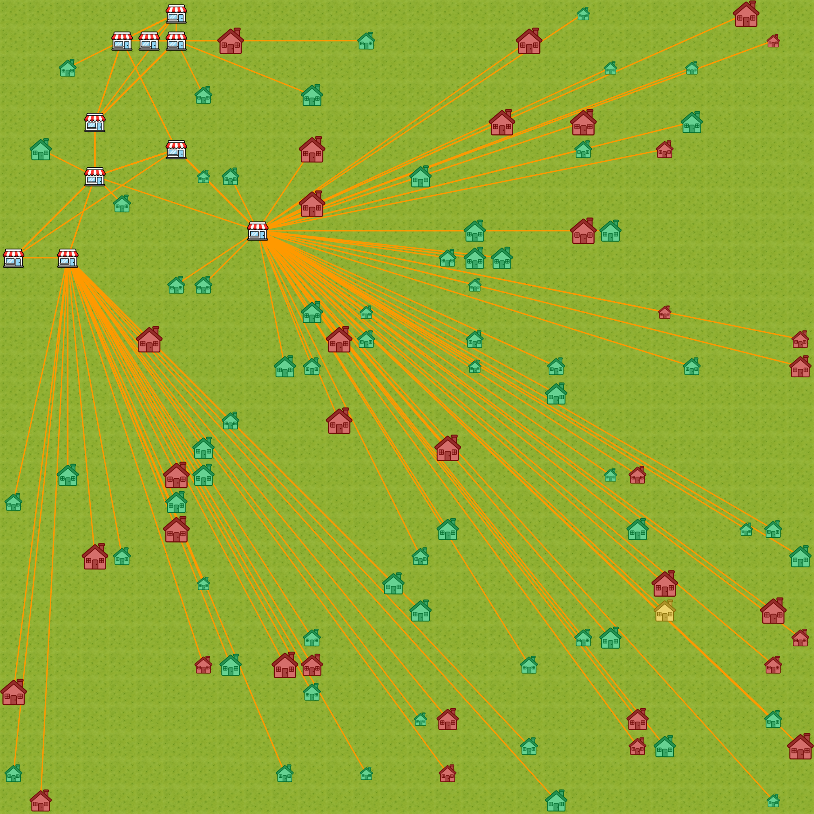

*Figure 20 — The food desert of Figure 19 with that day's shopping trips shown (`FEBTrip`, made visible in the Aspects panel). Every path ends in the north‑west corner. Households from the far side walk most of their 2 hours to get there, and then move from outlet to outlet looking for the categories they need.*

### What the design asks for but could not be measured yet

- **The outlet actually chosen** is measured only as the first outlet of the trip. Households always go to the nearest unvisited outlet, so "reliance on the nearest outlet" is 100 % by construction.
- **Stockouts by food category** are only counted in total, not per category.
- **Expenditure burden** is the share of budget spent. With one price for all food, it mostly reflects how much food could be found.

---

## 5. Limits

- **10 seeds, 90 steps.** The intervals in §3 are narrow for the run means. Household‑level results pool 1 000 households, but those come from only 10 layouts.
- **Money per household** mixes budget with household size in every scenario.
- **The walk home is not counted, and trips go on after the money runs out** (`recommendations.md` §2, item 1.2). Shopping minutes are therefore close to the 120‑minute limit everywhere, and time is not much of a constraint.
- **Random, demand‑blind restocking** causes most stockouts and the fragmentation seen with near outlets. It is a model rule, not a property of the food environment being studied.
- **Protein adequacy stays above 1** in every scenario but one group (5‑person households under scarce supply). Either the threshold (60 g per person) is low, or protein is not a limiting nutrient in this food basket.

---

## 6. Next steps

1. **Count the walk home in the time budget** before interpreting proximity further. Then repeat the unequal‑distance and food‑desert runs, ideally with shorter time budgets (1 h, as in combined scenario 3.1).
2. **Decide money per person,** then repeat the baseline. That separates the effect of household size from the effect of budget.
3. **Count stockouts per food category,** so that fresh foods (3‑day shelf life outside the fridge) can be told apart from staple foods.
4. **Run more seeds (30)** and longer runs (180 steps) for the published version. For the household‑level analysis, use regression with size, distance and preference profile as predictors instead of bands.
